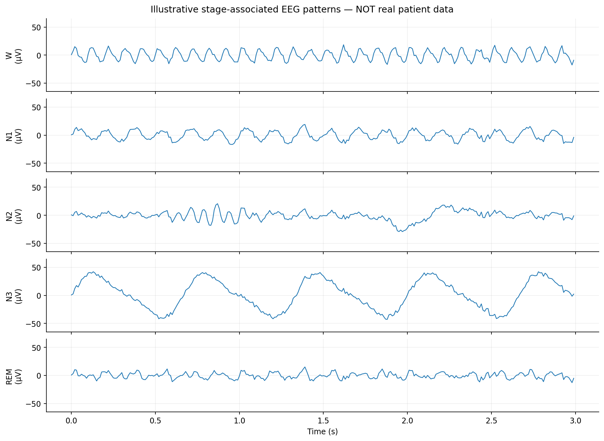
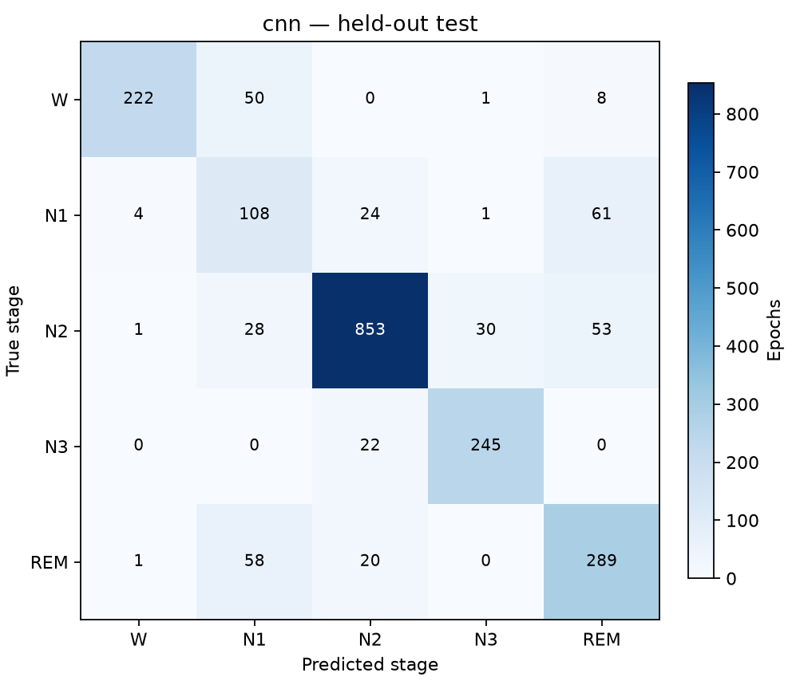
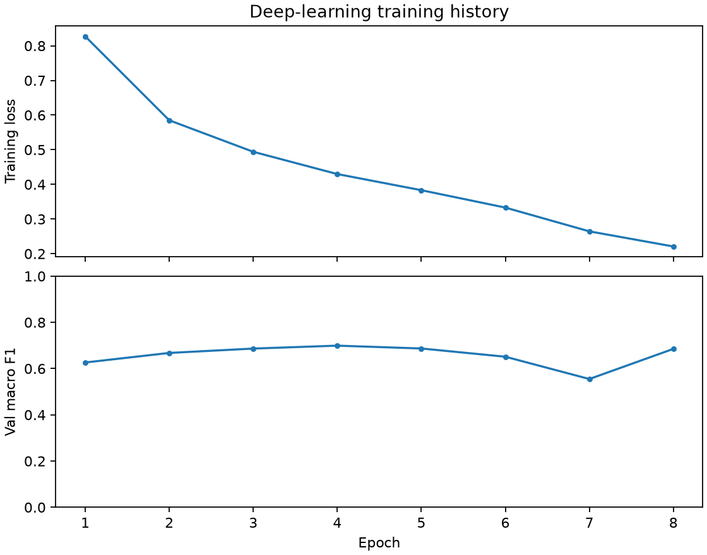

# Automatic Sleep Stage Classification from EEG

**A reproducible, modular research-software project for five-class sleep staging using the Sleep-EDF Expanded dataset.**

[](https://www.python.org/)
[](https://pytorch.org/)
[](.github/workflows/ci.yml)
[](LICENSE)

**Author:** [Oussama Beniaich](https://github.com/Ben10-L)

**Areas:** EEG · Computational Neuroscience · Machine Learning · Deep Learning · Biomedical Signal Processing · Explainable AI

## Abstract

I developed an end-to-end EEG sleep-staging research pipeline combining neurophysiological foundations, signal processing, automated extraction of expert-labeled 30-second epochs, interpretable classical ML baselines, lightweight deep neural networks, ensemble inference, explanation tools, and subject-independent evaluation. The target labels are **Wake (W), N1, N2, N3, and REM**. Both channels (`EEG Fpz-Cz`, `EEG Pz-Oz`) from the *Sleep-EDF Expanded / Sleep Cassette* subset are supported.

The project is organized into reusable Python modules, command-line workflows, 13 learning notebooks, unit tests, GitHub CI, and scientific documentation. It is designed to run **locally in Visual Studio Code**, including on Apple Silicon, without relying on hosted notebook services.

**Research status:** The pipeline has been run locally on a **nine-subject Sleep-EDF Expanded pilot cohort**. The repository includes observed evaluation metrics, confusion matrices, learning curves, an explanatory saliency example, and a generated experiment report. Raw EDF recordings, processed arrays, and trained model weights are intentionally excluded. These results are exploratory and are **not clinical validation or a full-dataset benchmark**. This software is not a medical device.



*Illustrative signal patterns synthesized for teaching — not patient or Sleep-EDF recordings.*

## Real-data pilot results

I evaluated the implementation using the **Sleep-EDF Expanded (Sleep Cassette)** dataset: **9 unique subjects, 8,781 labeled 30-second EEG epochs after pilot wake trimming, 2 EEG channels sampled at 100 Hz**. I used a subject-disjoint split, with 5 subjects / 4,624 epochs for training, 2 subjects / 2,078 epochs for validation, and **2 previously unseen subjects / 2,079 epochs** for testing (seed 42).

**Primary metric:** Macro F1, which gives equal weight to the five sleep-stage classes even when their frequencies differ. All results below are observed outputs from the local pilot experiments, not synthetic demonstrations.

| Model | Validation macro F1 | Test accuracy | Test macro F1 |
|---|---:|---:|---:|
| **1D-CNN** | **69.93%** | **82.59%** | **78.18%** |
| Equal-weight ensemble (CNN + BiLSTM + Transformer) | — | 80.81% | 76.74% |
| Logistic Regression | 66.95% | 79.85% | 75.05% |
| Transformer | 64.43% | 75.90% | 72.78% |
| CNN–BiLSTM | 54.53% | 68.88% | 67.95% |

Logistic Regression was selected over RBF-SVM and Random Forest by validation macro F1 within the classical ML pipeline. The CNN reached its best validation macro F1 at **epoch 4**, and achieved the highest test macro F1 among the listed runs. Its test F1 for **N1 was 48.87%**, identifying light-sleep discrimination as a major limitation. The equal-weight ensemble did not outperform the CNN alone.



*CNN confusion matrix on the held-out two-subject test partition; rows represent ground truth.*



*Training history; the best validation checkpoint was selected at epoch 4.*

Additional [model confusion matrices](results/real/figures/), [machine-readable metrics](results/real/), and the [generated experiment report](results/real/EXPERIMENT_REPORT.md) are provided for inspection.

**Interpretation and limitations:** This is a small **pilot study**, not a claim of generalizable clinical performance. Only two subjects contribute to the test set, so subject-level uncertainty is substantial. The test set has already been inspected across models; further model tuning based on it would risk optimistic bias. A more reliable study would pre-register the evaluation protocol, expand the cohort, repeat subject-level partitions or cross-validation, improve exact-time wake trimming, and evaluate additional recordings. Saliency images visualize input sensitivity, not neurological causality.

## Features

| Layer | Implementation | Location |
|---|---|---|
| Neuroscience foundations | Sleep architecture, EEG origins, waveforms, sampling | `notebooks/01_01*`, `01_02*` |
| Signal processing | Filtering, power spectral density, time-frequency analysis | `src/eeg_sleep/processing.py` |
| Dataset acquisition | Per-night verified MNE downloads, retry, incremental manifest | `src/eeg_sleep/downloading.py` |
| Dataset processing | EDF/hypnogram alignment, stage mapping, 30 s epochs | `src/eeg_sleep/dataset.py` |
| Pilot wake trimming | Per-recording trimming that preserves in-night wake epochs | `src/eeg_sleep/trimming.py` |
| Dataset audit | Class proportions, sample shapes, subject-disjoint splits | `src/eeg_sleep/audit.py` |
| Classical machine learning | Spectral/Hjorth features; Logistic Regression, calibrated RBF SVM, Random Forest | `src/eeg_sleep/features.py`, `ml.py` |
| Deep learning | 1D-CNN, CNN–BiLSTM, compact Transformer with MPS-compatible pooling | `src/eeg_sleep/models.py`, `deep_learning.py` |
| Model evaluation | Held-out subject metrics, per-class scores, predictions, limited cluster CI | `src/eeg_sleep/evaluation.py` |
| Ensemble | Fixed uniform probability averaging with strict sample alignment | `src/eeg_sleep/ensemble.py` |
| Explainable AI | Input-gradient saliency (interpret with care) | `src/eeg_sleep/explain.py` |
| Reports / figures | Real observed metrics only, confusion matrices, learning curves | `src/eeg_sleep/report.py`, `scripts/plot_experiment_results.py` |
| Documentation and checks | Learning notebooks, reference notes, automated tests, GitHub CI | `notebooks/`, `docs/`, `tests/`, `.github/` |

## Repository structure

```text
eeg-sleep-stage-classification/
├── .github/workflows/ci.yml
├── .vscode/                       # interpreter, notebook and task settings
├── configs/                       # pilot and research protocol metadata
├── data/
│   └── README.md                  # local raw/processed EDF data are Git-ignored
├── docs/                          # methodology, literature, limitations, learning path
├── figures/                       # educational illustrations (synthetic)
├── notebooks/                     # 13 Jupyter learning notebooks, phases 1–7
├── results/                       # selected real pilot metrics and figures; raw data/weights ignored
├── scripts/
│   ├── run_pipeline.py            # single CLI for experiment stages
│   ├── trim_wake_sleep_edf.py     # backward-compatible trim command
│   ├── migrate_existing_project.py
│   ├── plot_experiment_results.py
│   └── generate_lesson_figures.py
├── src/eeg_sleep/                 # tested reusable library
├── tests/                         # unit, integration and smoke tests
├── .gitignore
├── CITATION.cff
├── LICENSE
├── Makefile
└── pyproject.toml
```

## Installation — local VS Code

Use **Python 3.12** where possible. Project tests were run on Python 3.13 in the build environment; Apple Silicon **MPS must be verified on your Mac**, as CI does not include Apple GPUs. Python 3.15 is newer and may need additional compatibility testing.

```bash
cd eeg-sleep-stage-classification
python3.12 -m venv .venv
source .venv/bin/activate
python -m pip install --upgrade pip
python -m pip install -e '.[dev]'
python -m pytest -q
code .
```

In VS Code install Microsoft's **Python** and **Jupyter** extensions, then select `.venv/bin/python` as interpreter and notebook kernel. The `.ipynb` files are for exploration, explanation, and visualization; **production training runs are executed by Python modules and CLI commands**.

### Migrating from an older folder without losing data

If your existing project lives next to this extracted folder, first *preview* the copy:

```bash
python scripts/migrate_existing_project.py \
  --from-dir ../EEG_Sleep_Stage_Complete_Research_Course
```

When the paths and file counts look correct:

```bash
python scripts/migrate_existing_project.py \
  --from-dir ../EEG_Sleep_Stage_Complete_Research_Course --yes
```

The script **copies** `data/raw`, `data/processed`, and `results` and adjusts local manifest paths. It never deletes the original files, edits source code, copies the old `.venv`, or overwrites conflicting data. For the full procedure see [Migration guide](docs/MIGRATION.md).

## Real-data pipeline

The commands below show the intended order. EDF data and model weights are not included in the downloadable source archive.

### 1. Acquire data (only if missing)

```bash
python scripts/run_pipeline.py fetch \
  --subjects 0 1 2 3 4 5 6 7 8 --recordings 1
```

The downloader retrieves one pair at a time and persists the manifest after each success. **Interruptions do not erase completed entries.** Repeating the command uses MNE/Pooch's verified local cache. For additional subjects, request new IDs; the manifest merges them instead of replacing earlier pairs.

### 2. Preprocess and trim wake periods

```bash
python scripts/run_pipeline.py prepare
python scripts/run_pipeline.py trim
python scripts/run_pipeline.py inspect \
  --data data/processed/sleep_edf_trimmed.npz
```

Outputs are `data/processed/sleep_edf.npz` and `data/processed/sleep_edf_trimmed.npz`. The original processed archive is preserved. Trimming retains **30 minutes in retained annotated epochs** around first and last sleep per recording, and the intervening wake epochs. This is a **pilot approximation** when discarded movement or unknown annotation periods are present; a publication benchmark requires exact original-clock-time trimming.

### 3. Classical ML baselines

```bash
python scripts/run_pipeline.py ml \
  --data data/processed/sleep_edf_trimmed.npz \
  --output results/real/ml
```

The candidates are Logistic Regression, calibrated RBF-SVM, and Random Forest. Their **validation macro F1** determines one selected model, which is then evaluated against held-out test subjects. Older ML results were produced with a different SVM probability configuration; do not compare those artifacts as if they came from the same code revision without rerunning them.

### 4. Deep learning

```bash
python scripts/run_pipeline.py deep \
  --data data/processed/sleep_edf_trimmed.npz \
  --model cnn --epochs 20 --batch-size 16 --device auto \
  --output results/real/cnn

python scripts/run_pipeline.py deep \
  --data data/processed/sleep_edf_trimmed.npz \
  --model lstm --epochs 20 --batch-size 16 --device auto \
  --output results/real/lstm

python scripts/run_pipeline.py deep \
  --data data/processed/sleep_edf_trimmed.npz \
  --model transformer --epochs 20 --batch-size 16 --device auto \
  --output results/real/transformer
```

The models consume channel-first EEG tensors of shape `(batch, 2, 3000)`. Training uses train-only normalization, weighted cross-entropy, AdamW, gradient clipping, validation F1 for early stopping, and fixed subject-level partitions. Epoch-by-epoch loss/F1 is printed to the terminal.

**Apple Silicon fix:** the CNN/LSTM/Transformer replace problematic non-divisible `AdaptiveAvgPool1d` calls with explicitly padded fixed-width average pooling. This is an intentional architectural change, not necessarily numerically identical to the previous method. If your specific macOS/PyTorch configuration raises a *different* MPS operation error, use `--device cpu` and report the traceback.

### 5. Ensemble, explanations, and report

```bash
python scripts/run_pipeline.py ensemble \
  --inputs results/real/ml/ml_test_predictions.csv \
           results/real/cnn/cnn_test_predictions.csv \
  --output results/real/ensemble

python scripts/run_pipeline.py explain \
  --data data/processed/sleep_edf_trimmed.npz \
  --checkpoint results/real/cnn/cnn_checkpoint.pt \
  --output results/real/cnn/saliency.png --device cpu

python scripts/plot_experiment_results.py \
  --metrics results/real/cnn/cnn_metrics.json \
  --output results/real/figures

python scripts/run_pipeline.py report \
  --results results/real \
  --data data/processed/sleep_edf_trimmed.npz \
  --output results/real/EXPERIMENT_REPORT.md
```

Uniform averaging checks that prediction files describe the **same sample IDs, subjects, and true labels**. The report reads existing observed metrics, checks dataset provenance / hashes when available, and does **not** invent missing results. An explanation is a gradient-sensitivity visualization, **not a causal neuroscience explanation**.

## Dataset and evaluation protocol

| Property | Convention |
|---|---|
| Source | [Sleep-EDF Expanded](https://physionet.org/content/sleep-edfx/1.0.0/), Sleep Cassette subset |
| EEG leads | `EEG Fpz-Cz`, `EEG Pz-Oz` |
| Sampling rate | 100 Hz |
| Epoch length | 30 seconds |
| Labels | W, N1, N2, N3, REM |
| Mapping | R&K sleep stages 3/4 → N3; stage R → REM; movement/unknown excluded |
| Splitting | subject-disjoint train/validation/test, seed 42 |
| Primary comparison measure | macro F1, plus per-class performance and confusion matrix |
| Dataset provenance | stored in NPZ, run JSON, and dataset SHA-256 in new results |

These Sleep-EDF recordings use original annotation rules, not newly rescored AASM labels. Grouping by person ensures that two nights from the same subject cannot be split between training and test. A 9-subject pilot with only two test subjects is useful for debugging, **not** a strong clinical performance estimate. Repeatedly comparing architectures on the same test subjects can create optimistic bias. See [Protocol and limitations](docs/DATASET_AND_PROTOCOL.md).

## Education and reproducibility

The 13 notebooks cover sleep science, EEG generation, signal processing, dataset structure, literature, research design, classical ML, deep learning, ensembles, XAI, and scientific reporting. Begin with [Learning Path](docs/LEARNING_PATH.md). The [All source code reference](docs/ALL_PHASES_SOURCE_CODE.md) includes the exact checked-in Python source.

For an **offline software smoke test** (synthetic data; not a biological claim):

```bash
python scripts/run_pipeline.py demo --subjects 10 --repeats 2
python scripts/run_pipeline.py ml
python scripts/run_pipeline.py deep --model cnn --epochs 1 --device cpu
python scripts/run_pipeline.py explain --device cpu
python scripts/run_pipeline.py ensemble \
  --inputs results/ml/ml_test_predictions.csv results/deep/cnn_test_predictions.csv
python scripts/run_pipeline.py report
```

## Limitations and ethics

- This is research software and learning material; it must not be used for medical diagnosis.
- The pilot only uses two EEG derivations; sleep scoring by experts can also incorporate EOG and EMG.
- Non-stationary EEG, artifacts, label disagreement, and cross-subject distribution shift complicate generalization.
- The current nine-subject pilot and single partition do not support broad claims. Larger cohorts, exact timestamp trimming, cross-validation and external validation are important future scientific work.
- Raw Sleep-EDF and derived data are excluded from Git; consult PhysioNet's dataset license and cite the creators.
- Generated synthetic waveforms are illustrations, **never** real biomedical measurements.

## References

- [Sleep-EDF Expanded — PhysioNet](https://physionet.org/content/sleep-edfx/1.0.0/)
- [MNE sleep staging tutorial](https://mne.tools/stable/auto_tutorials/clinical/60_sleep.html)
- [MNE `sleep_physionet.age.fetch_data`](https://mne.tools/stable/generated/mne.datasets.sleep_physionet.age.fetch_data.html)
- [scikit-learn SVC and probability calibration](https://scikit-learn.org/stable/modules/generated/sklearn.svm.SVC.html)
- [PyTorch documentation](https://pytorch.org/docs/stable/)

See [Scientific references](docs/REFERENCES.md) and [`CITATION.cff`](CITATION.cff) for citation metadata.

## License

This repository's original **source code** is made available under the [MIT License](LICENSE). Sleep-EDF and other third-party materials have their own licenses and are not re-licensed by this repository.
